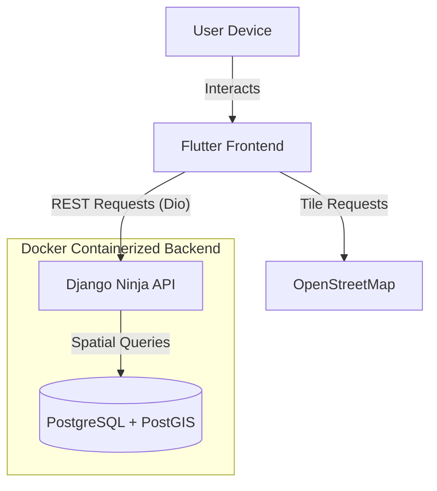

# Is It Open

**Is It Open** is a full-stack application designed to help users determine business hours and availability for various places. It features a robust Django backend with PostgreSQL/PostGIS for geospatial data and a responsive Flutter frontend for map-based interaction.

---

## 🛠 Tech Stack

### Backend
*   **Framework**: [Django](https://www.djangoproject.com/) + [Django Ninja](https://django-ninja.rest-framework.com/) (FastAPI-like syntax for Django)
*   **Database**: [PostgreSQL](https://www.postgresql.org/) with [PostGIS](https://postgis.net/) (Geospatial data support)
*   **Dependency Management**: [uv](https://github.com/astral-sh/uv)
*   **Containerization**: [Docker](https://www.docker.com/) & [Docker Compose](https://docs.docker.com/compose/)
*   **Utilities**: `python-decouple` (Config), `gunicorn` (WSGI Server)

### Frontend
*   **Framework**: [Flutter](https://flutter.dev/) (Dart)
*   **State Management**: [Bloc](https://bloclibrary.dev/)
*   **Maps**: [flutter_map](https://pub.dev/packages/flutter_map) with [latlong2](https://pub.dev/packages/latlong2)
*   **Networking**: [Dio](https://pub.dev/packages/dio)
*   **Other Key Libraries**: `calendar_view`, `shared_preferences`, `geolocator`

### Architecture



---

## ✨ Features

*   **Modern UI**: Fully overhauled **Glassmorphism** design with vibrant gradient backgrounds and frosted glass elements.
*   **Navigation**: Centralized **Side Menu** for quick access to Map, Search, Saved Places, Profile, and Settings.
*   **Geospatial Search**: Find places and business hours based on location (powered by PostGIS).
*   **Map Integration**: Interactive maps using OpenStreetMap tiles.
*   **Theme Control**: Light/Dark mode toggles with system reference.

---

## 📋 Prerequisites

Before you begin, ensure you have the following installed:
*   [Docker Desktop](https://www.docker.com/products/docker-desktop)
*   [Flutter SDK](https://docs.flutter.dev/get-started/install)
*   [Make](https://www.gnu.org/software/make/) (Standard on macOS/Linux)

---

## 🚀 Getting Started

### 1. Clone the Repository
```bash
git clone https://github.com/your-username/is-it-open.git
cd is-it-open
```

### 2. Environment Setup
Create a `.env` file in the `backend/` directory based on the sample:
```bash
cp backend/sample.env backend/.env
```
*Update the `.env` file with your specific configuration if necessary.*

### 3. Start the Backend (Docker)
We use `make` commands to simplify Docker interactions.
```bash
make up
```
This will:
1.  Build the backend container.
2.  Start the PostgreSQL/PostGIS database.
3.  Start the Django development server on port `8000`.

**Run Migrations:**
Once the containers are up, apply the database schema:
```bash
make migrate
```

### 4. Run the Frontend (Flutter)
Open a new terminal tab and navigate to the frontend directory:
```bash
cd frontend
flutter pub get
flutter run
```

### 5. Browse the Component Catalog (Widgetbook)
Every component and screen has [Widgetbook](https://www.widgetbook.io/) use cases backed by mock data, so no backend is needed:
```bash
cd frontend/widgetbook
flutter pub get
flutter run -d chrome
```
See [`frontend/widgetbook/README.md`](frontend/widgetbook/README.md) for adding use cases.

---

## 📂 Project Structure

```
is-it-open/
├── backend/                # Django Project
│   ├── apps/               # Django Apps (Feature modules)
│   │   ├── users/          # User management & Auth
│   │   ├── places/         # Place/POI data & Geospatial models
│   │   └── hours/          # Business hours logic
│   ├── config/             # Project settings (settings.py, urls.py)
│   ├── Dockerfile          # Backend container definition
│   └── pyproject.toml      # uv dependencies
│
├── frontend/               # Flutter Project
│   ├── lib/                # Dart source code
│   │   ├── components/     # Reusable UI widgets
│   │   ├── screens/        # App pages (Map, Me, etc.)
│   │   └── main.dart       # Entry point
│   ├── widgetbook/         # Widgetbook component catalog
│   └── pubspec.yaml        # Flutter dependencies
│
├── docker-compose.yml      # Service orchestration
└── Makefile                # Shortcut commands
```

---

## ⚡ Key Commands (Makefile)

Use these commands from the root directory to manage the project:

| Command | Description |
| :--- | :--- |
| `make up` | Start all services in the background (detached mode) |
| `make down` | Stop and remove all containers |
| `make build` | Rebuild the containers (run after adding new uv packages) |
| `make logs` | View backend logs in follow mode |
| `make shell` | Access the backend container's shell (`bash`) |
| `make migrate` | Run Django database migrations |
| `make makemigrations` | Create new migrations based on model changes |
| `make superuser` | Create a superuser for the Django Admin |

---